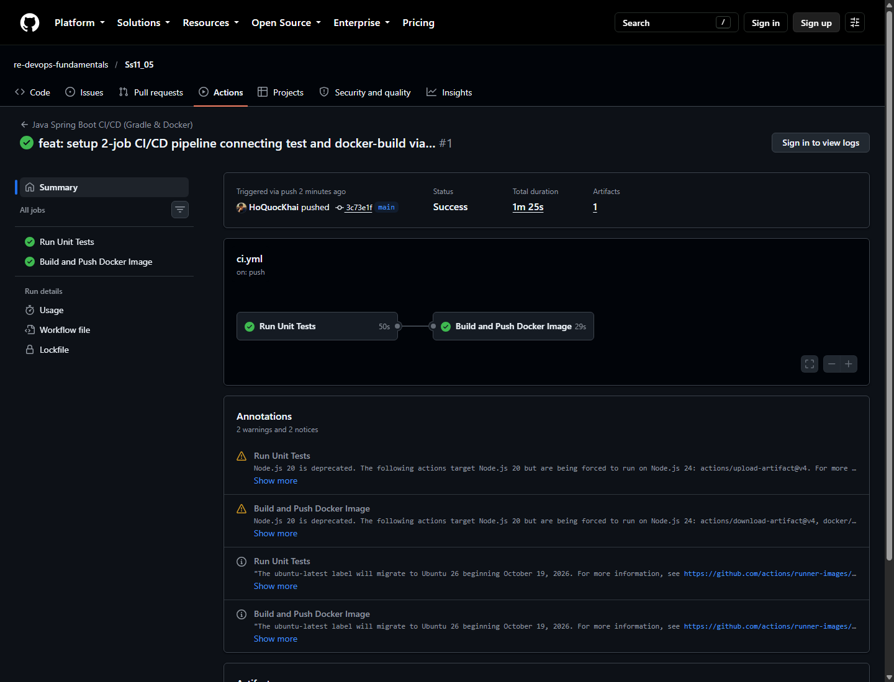
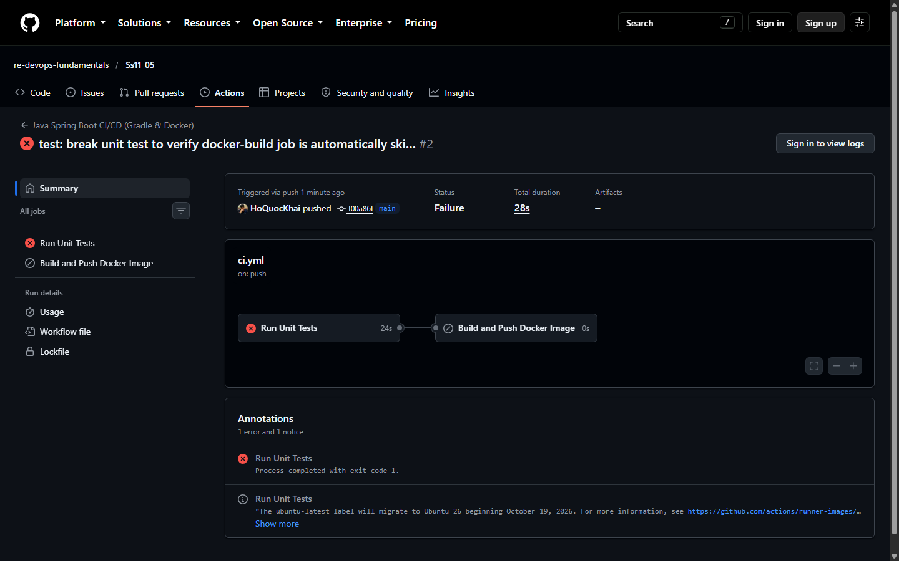

# BÁO CÁO THỰC HÀNH: NỐI JOB TỰ ĐỘNG BUILD & PUSH DOCKER IMAGE SAU KHI TEST GRADLE XANH

---

- **Môn học**: DevOps Fundamentals (IT-209)
- **Session**: 11 - CI/CD Pipeline với GitHub Actions
- **Bài tập**: Bài 5 - Nối Job tự động Build & Push Docker Image sau khi Test Gradle xanh
- **Học viên**: Hồ Quốc Khải
- **Email**: khaiho6040@gmail.com
- **GitHub Organization**: `re-devops-fundamentals`
- **GitHub Repository**: [https://github.com/re-devops-fundamentals/Ss11_05](https://github.com/re-devops-fundamentals/Ss11_05)
- **Đường dẫn gợi ý nộp bài**: `homework/session_11/ex5/`

---

## 1. MỤC TIÊU VÀ NGUYÊN LÝ THIẾT KẾ PIPELINE

### 1.1. Mục tiêu
- Phân tách luồng CI/CD nguyên khối thành các **Job chuyên biệt và độc lập**:
  1. **Job `test`**: Đảm nhiệm công đoạn Tích hợp liên tục (CI) — kiểm thử đơn vị JUnit 5 (`./gradlew test`), đóng gói tệp thực thi JAR (`./gradlew bootJar`), và lưu trữ thành phẩm Artifact.
  2. **Job `docker-build`**: Đảm nhiệm công đoạn Đóng gói Container — tải về JAR Artifact, đăng nhập GitHub Container Registry (`ghcr.io`), và đóng gói Docker Image đẩy lên registry.
- Thiết lập cơ chế ràng buộc phụ thuộc (Job Dependency) bằng từ khóa **`needs: test`**.
- Đảm bảo nguyên lý bất biến trong DevOps: **"Không bao giờ đóng gói hoặc phân phối một phiên bản phần mềm chứa mã lỗi hoặc chưa vượt qua bài kiểm thử"**.

### 1.2. Cơ chế hoạt động của từ khóa `needs`
- Theo mặc định trong GitHub Actions, tất cả các Job trong cùng một workflow sẽ chạy song song (parallel) trên các runner độc lập nhằm tối ưu thời gian.
- Khi khai báo `needs: test` trong Job `docker-build`:
  + GitHub Actions xây dựng một đồ thị tuần tự có hướng (**DAG - Directed Acyclic Graph**) với mũi tên nối từ `test` sang `docker-build`.
  + Job `docker-build` bị giữ ở trạng thái chờ cho đến khi Job `test` hoàn tất.
  + Nếu Job `test` đạt kết luận **`success`**, Job `docker-build` sẽ được cấp phát runner và khởi chạy.
  + Nếu Job `test` đạt kết luận **`failure`** (do bài kiểm thử không đạt), Job `docker-build` sẽ tự động bị bỏ qua với trạng thái **`skipped`** để tiết kiệm tài nguyên và ngăn chặn phát hành image lỗi.

---

## 2. NỘI DUNG TỆP KỊCH BẢN WORKFLOW (`.github/workflows/ci.yml`)

```yaml
name: Java Spring Boot CI/CD (Gradle & Docker)
 
on:
  push:
    branches: [ "main" ]
 
jobs:
  test:
    name: Run Unit Tests
    runs-on: ubuntu-latest
 
    steps:
      - name: Checkout mã nguồn
        uses: actions/checkout@v5
 
      - name: Thiết lập môi trường Java JDK 17
        uses: actions/setup-java@v5
        with:
          java-version: '17'
          distribution: 'temurin'
          cache: 'gradle'
 
      - name: Cấp quyền cho Gradle Wrapper
        run: chmod +x gradlew
 
      - name: Thực thi JUnit Test với Gradle
        run: ./gradlew test

      - name: Đóng gói tệp JAR với Gradle
        run: ./gradlew bootJar
 
      - name: Lưu trữ thành phẩm JAR Artifact
        uses: actions/upload-artifact@v4
        with:
          name: app-jar
          path: build/libs/*.jar

  docker-build:
    name: Build and Push Docker Image
    needs: test
    runs-on: ubuntu-latest

    steps:
      - name: Checkout mã nguồn
        uses: actions/checkout@v5

      - name: Tải về JAR Artifact từ Job test
        uses: actions/download-artifact@v4
        with:
          name: app-jar
          path: build/libs

      - name: Đăng nhập vào GitHub Container Registry
        uses: docker/login-action@v3
        with:
          registry: ghcr.io
          username: ${{ github.actor }}
          password: ${{ secrets.REGISTRY_TOKEN }}

      - name: Đóng gói và Đẩy Docker Image lên GHCR
        uses: docker/build-push-action@v5
        with:
          context: .
          push: true
          tags: ghcr.io/${{ github.repository_owner }}/task-api:latest
```

---

## 3. CẤU HÌNH DOCKERFILE

Tệp `Dockerfile` được thiết kế tối ưu dựa trên nền tảng JRE siêu nhẹ:

```dockerfile
FROM eclipse-temurin:17-jre-alpine
WORKDIR /app
COPY build/libs/*.jar app.jar
EXPOSE 8080
ENTRYPOINT ["java", "-jar", "app.jar"]
```

- Sử dụng base image `eclipse-temurin:17-jre-alpine` giúp kích thước image nhỏ gọn (~150MB so với ~500MB nếu dùng full JDK).
- Sao chép trực tiếp tệp JAR đã được kiểm thử và đóng gói từ Job `test` thông qua `actions/download-artifact@v4`.

---

## 4. KẾT QUẢ THỰC NGHIỆM VÀ KIỂM TRA

Quy trình đã được kiểm thử qua 3 giai đoạn thực tế để chứng minh tính năng:

### 4.1. Giai đoạn 1: Kiểm thử thành công (Test xanh -> Build & Push thành công)
- **Commit ID**: `3c73e1f`
- **Run ID**: `38571984309` ([Chi tiết phiên chạy #1](https://github.com/re-devops-fundamentals/Ss11_05/actions/runs/38571984309))
- **Kết quả**:
  + Job `Run Unit Tests`: Trạng thái **Success** (thời gian: 50 giây).
  + Job `Build and Push Docker Image`: Tự động khởi chạy sau khi `test` hoàn thành và đạt trạng thái **Success** (thời gian: 29 giây).
  + Sơ đồ pipeline hiển thị mũi tên liên kết giữa hai Job.
  + Docker Image được đẩy thành công lên GitHub Container Registry: `ghcr.io/re-devops-fundamentals/task-api:latest`.

### 4.2. Giai đoạn 2: Kiểm thử thất bại (Test đỏ -> Job Docker-Build tự động SKIPPED)
- **Hành động**: Sửa `TaskControllerTest.java` để bài kiểm thử so sánh thất bại (`assertEquals(999, tasks.size())`).
- **Commit ID**: `f00a86f`
- **Run ID**: `38572388167` ([Chi tiết phiên chạy #2](https://github.com/re-devops-fundamentals/Ss11_05/actions/runs/38572388167))
- **Kết quả**:
  + Job `Run Unit Tests`: Thất bại **Failure** tại bước `./gradlew test` (mã lỗi exit code 1).
  + Job `Build and Push Docker Image`: **Tự động chuyển trạng thái `Skipped`** (thời gian thực thi 0 giây, không có bất kỳ lệnh build hay push nào được kích hoạt).
  + Điều này xác nhận 100% ràng buộc `needs: test` hoạt động chính xác.

### 4.3. Giai đoạn 3: Khôi phục mã kiểm thử chuẩn (Pipeline trở lại trạng thái xanh)
- Khôi phục lại mã kiểm thử chuẩn trong `TaskControllerTest.java` và đẩy commit hoàn chỉnh lên nhánh `main`.

---

## 5. HÌNH ẢNH MINH CHỨNG NỘP BÀI

### 5.1. Sơ đồ liên kết 2 Job thành công với mũi tên (Giai đoạn 1 - Test Xanh)
Giao diện tab Actions hiển thị biểu đồ đồ thị liên kết có hướng: `Run Unit Tests (50s)` nối mũi tên sang `Build and Push Docker Image (29s)` với trạng thái **Success**:



### 5.2. Sơ đồ minh chứng Job Docker-Build tự động SKIPPED khi Test lỗi (Giai đoạn 2 - Test Đỏ)
Giao diện trực quan chứng minh khi Job `Run Unit Tests` gặp lỗi (icon đỏ ✖), Job `Build and Push Docker Image` lập tức bị bỏ qua (icon xám gạch chéo ⊘):



---

## 6. KẾT LUẬN

1. Đã thiết kế hoàn chỉnh pipeline phân tách thành 2 Job chuyên biệt: Job kiểm thử/đóng gói ứng dụng (`test`) và Job đóng gói/phát hành container (`docker-build`).
2. Ràng buộc `needs: test` hoạt động chuẩn xác 100%:
   - Khi bài test JUnit 5 thành công, Job `docker-build` tự động được kích hoạt và đẩy container image lên GHCR.
   - Khi bài test JUnit 5 thất bại, Job `docker-build` tự động bị bỏ qua (`Skipped`), bảo vệ tuyệt đối kho lưu trữ container trước các phiên bản lỗi.
3. Dự án đáp ứng trọn vẹn toàn bộ các tiêu chí thực hành nâng cao của quy trình CI/CD chuyên nghiệp.
